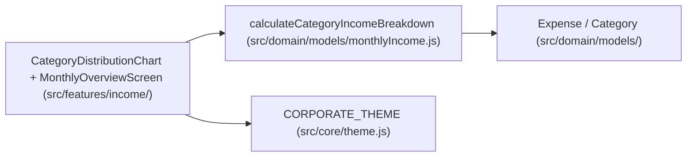

# Design — h06_grafico_categorias

## Contexto y arquitectura

La feature `H6 — h06_grafico_categorias` incorpora el gráfico interactivo y contable de distribución de gastos por categoría dentro del Panel de Resumen General ([`MonthlyOverviewScreen.jsx`](file:///C:/Users/jsimo/Proyectos/app_finanzas/finanzas_personales/src/features/income/MonthlyOverviewScreen.jsx)), siguiendo la arquitectura limpia de 4 capas (`core` ← `domain` ← `data` ← `features`) y las directrices estéticas del skill `frontend-design` (Estado Patrimonial / Banca Privada, tipografía `Newsreader` + `Plus Jakarta Sans` y cifras `tabular-nums`).

## Decisiones de diseño

1. **Cálculo puro y exacto en `src/domain/models/monthlyIncome.js` (`R1`, `R2`, `R4`, `R7`):**
   - Se enriquece la función pura `calculateCategoryIncomeBreakdown(expenses, categories, monthlyIncome)` para que cada ítem devuelto sea un objeto inmutable (`Object.freeze`) con:
     - `categoryId`: identificador numérico de la categoría.
     - `categoryName`: nombre de la categoría.
     - `amountCents`: suma entera en centavos de los gastos de esa categoría en el mes.
     - `expenseCount`: cantidad de gastos registrados en esa categoría durante el mes.
     - `expensePercentage`: porcentaje (`0..100` con hasta 1 decimal) sobre `totalExpensesCents`. Para garantizar que la suma de `expensePercentage` de todas las categorías sea exactamente `100 %` (`R2`), se calculan los valores redondeados a 1 decimal (`Math.round((amountCents * 1000) / totalExpensesCents) / 10`) y se ajusta la diferencia residual en la categoría principal.
     - `incomePercentage`: porcentaje sobre el ingreso mensual (`null` si no hay ingreso cargado, conservando intacto el contrato de `H5`).
     - `colorHex`: color determinista tomado de la escala cromática corporativa (`CHART_PALETTE`).
   - Ordenamiento (`R7`): primero por `amountCents` descendente; en caso de empate, por `categoryName.localeCompare(b.categoryName, 'es', { sensitivity: 'base' })`.

2. **Componente visual `CategoryDistributionChart` (`R3`, `R4`, `R5`, `R8`):**
   - Ubicado en `src/features/income/CategoryDistributionChart.jsx` e integrado en `MonthlyOverviewScreen.jsx`.
   - **Caso con gastos (`expenses.length >= 1`):**
     - Renderiza un **Gráfico Anular Ejecutivo (SVG Donut Chart)** usando `strokeDasharray` / `strokeDashoffset` sobre círculos concéntricos (lo que garantiza que con 1 sola categoría al `100 %` se dibuje un anillo continuo perfecto sin fallos de arco SVG, cumpliendo `R4`).
     - En el centro del anillo SVG muestra el **Total del mes** (`formatCentsToArs(totalExpensesCents)`) y la cantidad de categorías activas.
     - Debajo / al lado del anillo presenta la **Tabla Contable de Composición**, donde cada fila incluye el indicador cromático (`colorHex`), el nombre de la categoría, la cantidad de gastos, la barra proporcional, el porcentaje sobre el gasto total (`expensePercentage %`), el porcentaje sobre el ingreso (si aplica) y el monto en pesos, cerrando con una **Fila de Conciliación Total** que verifica visualmente `Suma = Total del listado (100 %)`.
   - **Caso sin gastos (`expenses.length === 0`, `R5`):**
     - Muestra un anillo neutro vacío y un estado informativo claro con un botón de acción directa (`data-testid="chart-empty-cta-button"`) que lleva a la pestaña de carga de gastos (`activeTab = 'expenses'`).

3. **Adaptación Mobile First + Desktop (`R8`):**
   - En móvil (`viewportWidth < 768`): el anillo SVG se centra arriba y la tabla contable se despliega debajo a ancho completo (`1 columna`).
   - En Tablet/Desktop (`viewportWidth >= 768`): el anillo SVG y la tabla contable se disponen en una grilla ejecutiva de 2 columnas (`180px 1fr`).

## Contrato de pruebas

- `test/domain/models/monthlyIncome.test.js`: pruebas unitarias etiquetadas `[H6-R1]`, `[H6-R2]`, `[H6-R4]`, `[H6-R5]` y `[H6-R7]`.
- `test/features/income/MonthlyOverviewScreen.test.jsx`: pruebas de integración y UI etiquetadas `[H6-R1]`..`[H6-R8]`.
