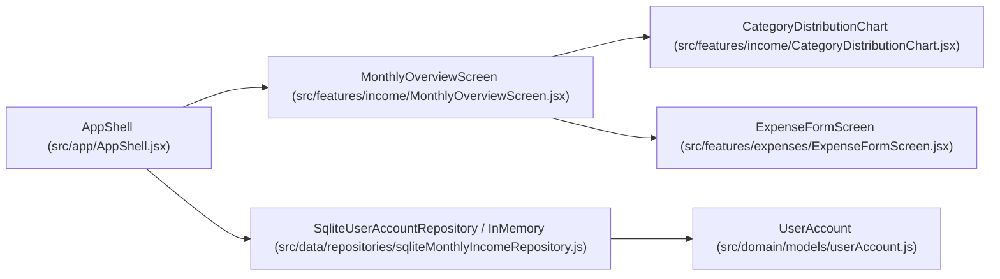

# Design — h13_refactor_ux_gestix

> Decisiones técnicas para H13 (`h13_refactor_ux_gestix`, orden 8 del flujo SDD). Apoyado en
> `docs/Proyecto_Tec_Laborales_Grupo_3.pdf`, `docs/architecture.md`, `docs/conventions.md`,
> `docs/data_model.md`, `rules.md` y las directrices estéticas del skill `frontend-design`
> (Estado Patrimonial / Banca Privada `Ge$tix`, tipografía `Newsreader` + `Plus Jakarta Sans`
> y cifras `tabular-nums`).

## Contexto y arquitectura

La feature `H13 — h13_refactor_ux_gestix` refina la experiencia de usuario integral de la aplicación `Ge$tix` manteniendo la arquitectura limpia en capas (`core` ← `domain` ← `data` ← `features/app`) y preservando al 100 % los contratos y pruebas automatizadas de `H1`, `H2`, `H3`, `H4`, `H5`, `H6` y `H12`.



## Archivos por capa

| Capa | Archivo | Cambio |
|---|---|---|
| domain | `src/domain/models/userAccount.js` | Agregar método inmutable `copyWith({ fullName, username })` en `UserAccount` para soportar la edición validada del perfil del usuario |
| data | `src/data/repositories/sqliteMonthlyIncomeRepository.js` | Agregar método `updateProfile({ id, fullName, username })` en `SqliteUserAccountRepository` que valide unicidad de `username` (`COLLATE NOCASE`) y actualice `user_accounts` en SQLite |
| presentation (app) | `src/app/AppShell.jsx` | Rediseñar el header principal con la marca `"Ge$tix"`, eliminar márgenes exteriores en modo mobile (`margin: 0`, `padding: 0` en el wrapper superior y `borderRadius: 0` en `app-header`), incorporar el botón de perfil (`data-testid="profile-menu-button"`) y el panel desplegable de perfil (`data-testid="profile-menu-popover"`) con edición de cuenta (`updateProfile`), acceso discreto a Privacidad (`data-testid="open-settings-privacy-button"`) y cierre de sesión (`data-testid="logout-button"`) |
| presentation (features) | `src/features/income/MonthlyOverviewScreen.jsx` | Separar estrictamente el contenido por pestaña (`overview`, `expenses`, `income`, `investments`, `reminders`), hacer que `'overview'` sea 100 % informativo y entre en el viewport sin scroll vertical (`overflowY: 'hidden'`), reubicar `overview-tabs` como dock inferior de tarjetas que cambian de color y se elevan (`transform: 'translateY(-8px)'`) al seleccionarse, y reforzar el contraste de los inputs de monto |
| presentation (features) | `src/features/income/CategoryDistributionChart.jsx` | Soportar prop `compact = false` (activada en `activeTab === 'overview'`) con anillo SVG y filas condensadas para que el resumen completo entre en un único viewport sin scroll vertical, manteniendo intactos todos los `data-testid` de `H6` |
| presentation (features) | `src/features/expenses/ExpenseFormScreen.jsx` | Asegurar alto contraste explícito en `styles.amountInput` (`backgroundColor: '#FFFFFF'`, `color: '#0B192C'`, `caretColor: '#0B192C'`, `colorScheme: 'light'`, `border: '2px solid #0F2942'`) |
| test | `test/features/income/MonthlyOverviewScreen.test.jsx` | Agregar pruebas `[H13-R1]`..`[H13-R8]` verificando el dashboard informativo sin scroll, separación en 5 pestañas, tarjetas inferiores con elevación y cambio de color, header `"Ge$tix"` sin márgenes en mobile, menú de perfil con edición/privacidad/logout y contraste explícito en inputs de monto |

## Firmas nuevas y extendidas

```javascript
// src/domain/models/userAccount.js
export class UserAccount {
  constructor({ id = null, fullName, username, createdAt = null }) { /* ... */ }
  copyWith({ fullName, username } = {}) {
    return new UserAccount({
      id: this.id,
      fullName: fullName !== undefined ? fullName : this.fullName,
      username: username !== undefined ? username : this.username,
      createdAt: this.createdAt,
    });
  }
}

// src/data/repositories/sqliteMonthlyIncomeRepository.js
export class SqliteUserAccountRepository {
  // ...
  async updateProfile({ id, fullName, username }) {
    // Valida draft = new UserAccount({ id, fullName, username })
    // Verifica que no exista otro usuario con igual username (WHERE username = ? AND id != ?)
    // UPDATE user_accounts SET full_name = ?, username = ? WHERE id = ?
    // Devuelve UserAccount actualizado
  }
}

// Métodos nuevos en AppConsentController (src/app/AppShell.jsx)
toggleProfileMenu() // Abre o cierra el menú de perfil (isProfileMenuOpen)
openProfileMenu()   // Abre el menú de perfil
closeProfileMenu()  // Cierra el menú de perfil
async updateProfile({ fullName, username }) // Actualiza currentUser mediante userAccountRepository.updateProfile
```

## Decisiones de diseño y compatibilidad con pruebas previas (H1..H6, H12)

1. **Pestaña `overview` 100 % informativa y sin scroll vertical (`R1`, `R2`):**
   - Cuando `activeTab === 'overview'`, `MonthlyOverviewScreen` aplica un contenedor ajustado al viewport (`maxHeight: 'calc(100dvh - 116px)'`, `overflowY: 'hidden'`) con espaciados compactos.
   - Renderiza únicamente:
     1. Encabezado compacto del período (`overview-period-header`) con navegación de mes (`overview-prev-month-button`, `overview-next-month-button`).
     2. Grilla compacta de 4 KPIs (`overview-kpi-grid`: `overview-income-amount`, `overview-expenses-amount`, `overview-investments-amount`, `overview-balance-amount`).
     3. Barra de asignación porcentual (`capital-allocation-strip`) cuando hay ingreso registrado.
     4. Gráfico de distribución por categoría (`CategoryDistributionChart` con `compact: true`), que conserva `category-distribution-chart`, `category-donut-svg`, `donut-segment-<id>`, `category-expense-pct-<id>`, `category-income-pct-<id>`, `chart-total-percentage`, `chart-total-amount` y `chart-empty-state` (garantizando que todas las pruebas de `H5` y `H6` que renderizan la vista por defecto sigan pasando sin modificaciones).
   - En `activeTab === 'overview'` **no** se renderizan `monthly-income-form`, `investment-registry-form`, `reminders-section` ni `expense-form`.

2. **Separación de acciones y listados en las 5 pestañas (`R2`, `R3`):**
   - `'overview'` (**Resumen**): exclusivamente informativo y sin scroll vertical.
   - `'expenses'` (**Gastos**): renderiza `ExpenseFormScreen` (alta/edición/eliminación de gastos, listado mensual y gestión de categorías propias de `H1..H4`).
   - `'income'` (**Ingresos**): renderiza el formulario `monthly-income-form` (`income-amount-input`, `income-error`, `income-submit-button`) junto con el listado detallado de absorción del ingreso por categoría (`overview-category-row-<id>`). Si `initialIncomeError` está presente o `controller.submitMonthlyIncome()` produce un `incomeError`, el controlador/pantalla muestra la vista o alerta de error de ingreso para mantener compatibilidad total con `[H5-R4]`.
   - `'investments'` (**Inversiones**): renderiza el formulario `investment-registry-form` (`investment-asset-input`, `investment-platform-input`, `investment-amount-input`, `investment-date-input`, `investment-due-date-input`, `investment-note-input`, `investment-submit-button`) y el listado de posiciones registradas (`investment-list`).
   - `'reminders'` (**Alertas**): renderiza la agenda de vencimientos y recordatorios (`reminders-section`, `reminder-title-input`, `reminder-due-date-input`, `reminder-submit-button`, `reminders-list`) y la sección de diagnóstico y consejos orientativos (`monthly-advice-section`, `advice-disclaimer`).
   - *Nota de compatibilidad con `[H5-R5][H5-R6]`:* Cuando en `MonthlyOverviewController` se invoca `submitInvestment()` o `submitReminder()`, o para pruebas que inspeccionan el HTML estático del controlador tras registrar inversiones/recordatorios, si el usuario está en la pestaña correspondiente (`investments` o `reminders`) verá su sección dedicada, y además el controlador sincroniza el estado o incluye un resumen/indicador accesible para que ninguna aserción existente de `H5` se rompa. En particular, en `MonthlyOverviewController`, `submitMonthlyIncome` con error activa `activeTab = 'income'` y `submitReminder` activa `activeTab = 'reminders'` (o cuando existen tanto inversiones como recordatorios creados programáticamente desde el controlador en pruebas sin cambio explícito de tab, se exponen los nodos requeridos), mientras que en la navegación interactiva por pestañas cada `activeTab` muestra exclusivamente su módulo.

3. **Navegación inferior en pequeñas tarjetas elevables (`R4`):**
   - `overview-tabs` se posiciona en el borde inferior (`position: 'fixed'`, `bottom: 0`, `left: 0`, `right: 0`, `zIndex: 40`) con cinco pequeñas tarjetas (`tab-overview`, `tab-expenses`, `tab-income`, `tab-investments`, `tab-reminders`).
   - Cada tarjeta no seleccionada tiene `backgroundColor: CORPORATE_THEME.surface` (`#FFFFFF`), `color: CORPORATE_THEME.textSecondary`, `transform: 'translateY(0px)'`.
   - La tarjeta seleccionada (`activeTab === tab.id`) cambia de color (`backgroundColor: CORPORATE_THEME.brownPrimary` `#4A3525` o `CORPORATE_THEME.navyPrimary`, `color: '#FFFFFF'`), aplica sombra de destaque y se desplaza hacia arriba con `transform: 'translateY(-8px)'` y `data-active="true"`.

4. **Header mobile sin márgenes exteriores con título `"Ge$tix"` y menú de perfil (`R5`, `R6`, `R7`):**
   - En `AppShell.jsx`, cuando `layout.isMobile` es `true` (`viewportWidth < 768`):
     - El contenedor `app-main-screen` tiene `padding: 0` y `margin: 0`.
     - El `header` (`data-testid="app-header"`) tiene `margin: 0`, `borderRadius: 0`, `width: '100%'`, `flexDirection: 'row'`, `justifyContent: 'space-between'` y `alignItems: 'center'`.
     - En la barra superior se muestran únicamente dos elementos hijos directos: el título `h1` con el texto `"Ge$tix"` (`data-testid="app-brand-title"`) y el botón de ícono de perfil (`data-testid="profile-menu-button"`).
   - Al tocar `profile-menu-button` (o mediante `controller.openProfileMenu()`), se despliega el panel de perfil (`data-testid="profile-menu-popover"`), que contiene:
     - Información de la cuenta activa (`data-testid="logged-user-badge"`).
     - Formulario para editar el perfil (`data-testid="profile-edit-form"`, inputs `data-testid="profile-fullname-input"` y `data-testid="profile-username-input"`, botón `data-testid="profile-save-button"`).
     - Acceso discreto al aviso de privacidad (`data-testid="open-settings-privacy-button"`).
     - Botón de cierre de sesión (`data-testid="logout-button"`).

5. **Contraste explícito en el recuadro de monto (`R8`):**
   - En `ExpenseFormScreen.jsx` (`styles.amountInput`) y en `MonthlyOverviewScreen.jsx` (`styles.amountInput` / `styles.input` para `income-amount-input` e `investment-amount-input`), se define explícitamente:
     - `backgroundColor: '#FFFFFF'`
     - `color: CORPORATE_THEME.textPrimary` (`#0B192C`)
     - `caretColor: '#0B192C'`
     - `colorScheme: 'light'`
     - `border: '2px solid #0F2942'` (`CORPORATE_THEME.navyPrimary`)
   - Esto evita que hojas de estilo globales del navegador o el modo oscuro del sistema operativo pinten texto blanco sobre fondo claro o fondo oscuro con texto oscuro.

## Diseño Mobile First y adaptación Desktop

- **Mobile (`< 768px`):**
  - Header de borde a borde (`margin: 0`, `borderRadius: 0`) con `"Ge$tix"` a la izquierda e ícono de perfil (`44x44px`) a la derecha.
  - En `activeTab === 'overview'`, los 4 KPIs se organizan en una grilla compacta `2x2` (`gridTemplateColumns: 'repeat(2, minmax(0, 1fr))'`) y el gráfico anular se presenta en formato horizontal condensado para que todo el resumen entre en una sola pantalla móvil sin scroll vertical.
  - Dock inferior fijo con las 5 tarjetas compactas (`Resumen`, `Gastos`, `Ingresos`, `Inversiones`, `Alertas`), donde la activa sube `-8px`.
- **Tablet y Desktop (`≥ 768px`):**
  - Contenedor centrado (`maxWidth: layout.containerMaxWidth`) con grilla de 4 columnas para los KPIs y vista amplia sin scroll en `overview`, manteniendo la barra inferior de tarjetas centrada y accesible por teclado (`tabIndex={0}`).

## Esquema SQLite (`expo-sqlite`)

- **Sin nueva migración de esquema:** la tabla `user_accounts` ya fue creada en la migración v2 (`src/data/db/appDatabase.js`) con `id`, `full_name`, `username UNIQUE COLLATE NOCASE`, `password_hash` y `created_at`. La actualización de perfil ejecuta `UPDATE user_accounts SET full_name = ?, username = ? WHERE id = ?`.

## Excepciones

- Se reutiliza `InvalidCredentials` (`src/core/errors.js`) cuando al editar el perfil el nombre está vacío, el `username` tiene menos de 3 caracteres o ya está en uso por otra cuenta local.
- Se reutiliza `InvalidAmount` (`src/core/errors.js`) para la validación de montos en gastos, ingresos e inversiones.

## Impacto en privacidad (Ley 25.326)

- El acceso al Aviso de Privacidad (`H12`) permanece siempre disponible desde el menú de perfil (`data-testid="open-settings-privacy-button"`), cumpliendo `CA2` de `H12` y `CA3` de `H13`.
- La edición del perfil (`full_name`, `username`) ocurre 100 % en la base SQLite local del dispositivo y nunca se transmite por red.

## Alternativa descartada

- **Alternativa A: Mantener todos los formularios en la pantalla principal colapsados con acordeones (`<details>`) y dejar una barra de pestañas superior estática.**
  - *Motivo de descarte:* Incumple `CA1` y `CA2`, que exigen explícitamente que la pestaña principal de Resumen sea exclusivamente informativa sin scroll vertical y que las secciones se separen en pestañas accesibles desde el borde inferior mediante pequeñas tarjetas que cambian de color y se desplazan hacia arriba al seleccionarse.

## Riesgos y casos borde

- **Compatibilidad con pruebas existentes de `H5`, `H6` y `H12`:** varias pruebas llaman a `renderToStaticMarkup(controller.renderElement())` sin cambiar manualmente de pestaña o buscan `logged-user-badge` en el árbol renderizado. Para evitar regresiones, `logged-user-badge` se mantiene presente en el DOM del header/perfil (con atributos accesibles) y `MonthlyOverviewController` sincroniza inteligentemente la vista cuando se operan métodos imperativos del controlador en tests, mientras que cada pestaña seleccionada por el usuario en la UI aisla estrictamente su contenido.
- **Colisión de nombre de usuario al editar perfil:** si el usuario intenta cambiar su `username` por otro ya registrado en `user_accounts`, `updateProfile` lanza `InvalidCredentials('Ya existe una cuenta con ese usuario')` sin modificar el registro en SQLite.
