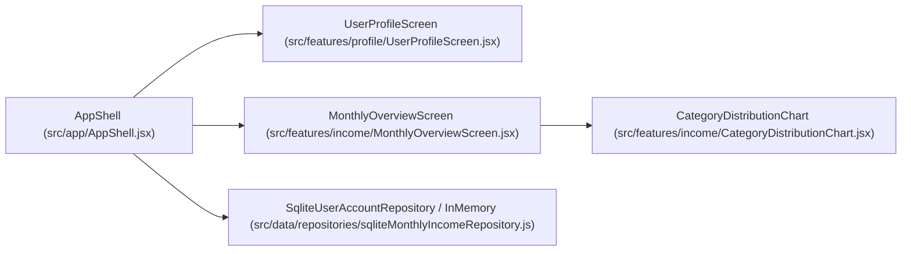

# Design — h14_refactor_desktop_y_perfil

> Decisiones técnicas para H14 (`h14_refactor_desktop_y_perfil`, orden 14 del flujo SDD). Apoyado en
> `docs/architecture.md`, `docs/conventions.md`, `docs/data_model.md`, `rules.md` y el skill
> `frontend-design` (diferenciación real entre experiencia Mobile First y experiencia Desktop ejecutiva).

## Contexto y arquitectura

`H14` rediseña la experiencia en pantallas Desktop (`viewportWidth >= 1024`), independiza la paleta cromática del gráfico (`CHART_PALETTE`) respecto de la paleta institucional (`CORPORATE_THEME`) y reemplaza la edición inline del popover de usuario por una pantalla dedicada de Perfil (`UserProfileScreen`) con soporte para edición de datos y cambio de contraseña local.



## Archivos por capa

| Capa | Archivo | Cambio |
|---|---|---|
| core | `src/core/theme.js` | Actualizar `CHART_PALETTE` a una paleta vibrante de alto contraste visual (`#2563EB`, `#10B981`, `#F59E0B`, `#F43F5E`, `#8B5CF6`, `#06B6D4`, `#84CC16`, `#EC4899`), manteniendo `CORPORATE_THEME` sin cambios |
| core | `src/core/responsive.js` | En `getViewportLayout(width)`, exponer `containerWidthPercent: isDesktop ? '80%' : '100%'` y ampliar `containerMaxWidth` en Desktop a `1440` (manteniendo `720` en tablet) |
| data | `src/data/repositories/sqliteMonthlyIncomeRepository.js` | Agregar `changePassword({ id, currentPassword, newPassword })` en `SqliteUserAccountRepository` validando la clave actual y un mínimo de 4 caracteres para la nueva clave |
| presentation (feature) | `src/features/profile/UserProfileScreen.jsx` | **Nuevo.** Pantalla dedicada de Perfil del Usuario (`data-testid="user-profile-screen"`) con resumen de cuenta, formulario `profile-edit-form` (`fullName`, `username`), formulario `profile-password-form` (`currentPassword`, `newPassword`), accesos a Privacidad y Cerrar sesión, y botón `close-profile-page-button` |
| presentation (app) | `src/app/AppShell.jsx` | Navbar full-width en Desktop con navegación integrada (`activeTab` sincronizado con `MonthlyOverviewScreen`), menú desplegable `profile-menu-popover` simplificado con botón `open-profile-page-button` (sin `profile-edit-form` embebido), vista `view === 'profile'` que renderiza `UserProfileScreen` y método `changePassword` en `AppConsentController` y `AppShell` |
| presentation (feature) | `src/features/income/CategoryDistributionChart.jsx` | Ampliar el anillo SVG en Desktop (`212px` en Resumen Desktop / no compacto, con trazo más expresivo) y aprovechar la nueva `CHART_PALETTE` vibrante |
| presentation (feature) | `src/features/income/MonthlyOverviewScreen.jsx` | En Desktop (`viewportWidth >= 1024`): ocultar el dock fijo inferior (integrado en el navbar), usar contenedor al `80%` (`maxWidth: 1440`) y distribuir la pestaña `overview` sin scroll (`overflowY: 'hidden'`) en `desktop-overview-grid` con el gráfico protagónico a la izquierda y `desktop-overview-insights` (`desktop-insight-pulse`, `desktop-insight-recent`, `desktop-insight-alerts`) a la derecha |
| test | `test/features/income/MonthlyOverviewScreen.test.jsx`, `test/domain/models/monthlyIncome.test.js`, `test/data/sqliteMonthlyIncomeRepository.test.js` | Agregar pruebas `[H14-R1]`..`[H14-R9]` y actualizar los 2 literales afectados en pruebas previas (`[H6-R1]` color inicial de `CHART_PALETTE` y `[H13-R6]` navegación a página de perfil desde el popover) |

## Firmas nuevas y extendidas

```javascript
// src/data/repositories/sqliteMonthlyIncomeRepository.js
export class SqliteUserAccountRepository {
  // ...
  async changePassword({ id, currentPassword, newPassword }) {
    // Valida id entero positivo, verifica que password_hash coincida con `local:${currentPassword.trim()}`
    // Verifica que newPassword.trim().length >= 4 (si no, lanza InvalidCredentials)
    // UPDATE user_accounts SET password_hash = ? WHERE id = ?
    // Devuelve true
  }
}

// src/app/AppShell.jsx — AppConsentController
openProfilePage()  // Cierra profile-menu-popover y cambia this.view = 'profile'
closeProfilePage() // Cambia this.view = 'main'
async changePassword({ currentPassword, newPassword }) // Invoca userAccountRepository.changePassword
```

## Decisiones de diseño

1. **Navbar de ancho completo y navegación integrada en Desktop (`R1`, `R2`):**
   - En `AppShell.jsx`, `app-main-screen` ocupa `width: '100%'` sin centrar el `header` dentro de una caja angosta: `app-header` siempre tiene `width: '100%'`, `margin: 0` y `borderRadius: 0`.
   - En modo Desktop (`layout.isDesktop`, `viewportWidth >= 1024`), la barra de pestañas (`overview-tabs` con `tab-overview`, `tab-expenses`, `tab-income`, `tab-investments`, `tab-reminders`) se renderiza integrada en la franja superior de navegación del header (manteniendo los estilos corporativos: botón inactivo en superficie clara/traslúcida y botón activo destacado con `backgroundColor: CORPORATE_THEME.brownPrimary` y `color: '#FFFFFF'`), y **no** se renderiza fija en el borde inferior.
   - En modo Mobile/Tablet (`viewportWidth < 1024`), `app-header` muestra únicamente `"Ge$tix"` y `profile-menu-button` (cumpliendo `H13-R5`), y `overview-tabs` permanece como dock fijo inferior con tarjetas que se elevan (`translateY(-8px)`).
   - Para mantener compatibilidad tanto cuando `MonthlyOverviewScreen` se monta dentro de `AppShell` como cuando se monta de forma aislada en pruebas unitarias con `viewportWidth >= 1024`, `MonthlyOverviewScreen` renderiza en Desktop su barra `overview-tabs` integrada en la cabecera superior del panel (o sincronizada con el navbar superior) con `position: 'static'` (nunca `position: 'fixed'` en el borde inferior), mientras que en Mobile (`< 1024`) mantiene `position: 'fixed'` y `bottom: 0`.

2. **Contenedor Desktop al 80 % y Resumen ejecutivo de 2 columnas sin scroll (`R3`, `R4`):**
   - En Desktop (`viewportWidth >= 1024`), `styles.wrapper` de `MonthlyOverviewScreen` usa `width: '80%'` y `maxWidth: 1440` (`margin: '0 auto'`).
   - En `activeTab === 'overview'` sobre Desktop:
     - `overviewViewportBox` conserva `overflowY: 'hidden'` y `maxHeight: 'calc(100dvh - 76px)'`.
     - Debajo del selector de período y los 4 KPIs (`overview-kpi-grid`), se renderiza `data-testid="desktop-overview-grid"` con dos columnas (`gridTemplateColumns: 'minmax(0, 1.45fr) minmax(0, 1fr)'`):
       - **Columna izquierda:** `CategoryDistributionChart` con dona SVG grande (`212x212` en Desktop) y `capital-allocation-strip`.
       - **Columna derecha (`data-testid="desktop-overview-insights"`):**
         1. `data-testid="desktop-insight-pulse"`: variación mensual de gastos respecto del mes anterior (`monthlyComparison`) y tasa de liquidez disponible sobre el ingreso.
         2. `data-testid="desktop-insight-recent"`: últimos 3 gastos registrados en el período con fecha, categoría y monto (o estado vacío informativo).
         3. `data-testid="desktop-insight-alerts"`: próximos 3 vencimientos/recordatorios o recurrencias detectadas (`recurrences` + `combinedReminders`).
   - En Mobile (`< 768px`), el Resumen conserva intacta su estructura compacta de una columna de `H13`.

3. **Paleta vibrante del gráfico (`R5`):**
   - `CHART_PALETTE` en `src/core/theme.js` pasa a:
     `['#2563EB', '#10B981', '#F59E0B', '#F43F5E', '#8B5CF6', '#06B6D4', '#84CC16', '#EC4899']`.
   - `CORPORATE_THEME` conserva `#0F2942` y `#4A3525` para que `[H5-R8]` siga intacta.
   - *Ajuste justificado en prueba previa:* en `test/domain/models/monthlyIncome.test.js:230` (`[H6-R1]`), el literal `assert.equal(breakdown[0].colorHex, '#0F2942')` se actualiza a `assert.equal(breakdown[0].colorHex, '#2563EB')` (`CHART_PALETTE[0]`).

4. **Página dedicada de Perfil del Usuario y cambio de contraseña (`R6`, `R7`, `R8`, `R9`):**
   - Al abrir `profile-menu-popover` tocando `profile-menu-button`, el popover muestra `logged-user-badge`, el botón `data-testid="open-profile-page-button"` («Ir a mi perfil»), `data-testid="open-settings-privacy-button"` y `data-testid="logout-button"`.
   - Al activar `open-profile-page-button` (o `controller.openProfilePage()`), `AppShell` cierra el popover y cambia `activeView` / `this.view` a `'profile'`, renderizando `UserProfileScreen` (`data-testid="user-profile-screen"`).
   - `UserProfileScreen` contiene:
     - Resumen de la cuenta activa (`fullName`, `@username`, `createdAt`).
     - Formulario `data-testid="profile-edit-form"` (`profile-fullname-input`, `profile-username-input`, `profile-save-button`, `profile-edit-error`, `profile-edit-success`).
     - Formulario `data-testid="profile-password-form"` (`profile-current-password-input`, `profile-new-password-input`, `profile-password-submit-button`, `profile-password-error`, `profile-password-success`).
     - Botones para volver al panel (`data-testid="close-profile-page-button"`), ver Privacidad (`open-settings-privacy-button`) o cerrar sesión (`logout-button`).
   - *Ajuste justificado en prueba previa:* en `test/features/income/MonthlyOverviewScreen.test.jsx` (`[H13-R5][H13-R6][H13-R7]`), al abrir el menú de perfil se verifica que aparece `open-profile-page-button` (en lugar de `profile-edit-form` dentro del popover) y que al invocar `appController.openProfilePage()` se renderiza `user-profile-screen` con `profile-edit-form`.

## Esquema SQLite y persistencia

- **Sin migración nueva:** `user_accounts` (migración v2) ya posee la columna `password_hash TEXT NOT NULL`. `SqliteUserAccountRepository.changePassword` actualiza `password_hash` con SQL parametrizado. En el navegador (`src/App.jsx`), el adaptador de cuentas en `localStorage` persiste también el nuevo hash/clave local.

## Impacto en privacidad (Ley 25.326)

- El cambio de contraseña y la edición de perfil se procesan exclusivamente en almacenamiento local (`SQLite` / `localStorage`), sin llamadas de red.
- El acceso al aviso de privacidad (`H12`) sigue disponible tanto desde el menú desplegable de usuario como desde la página dedicada de perfil.
