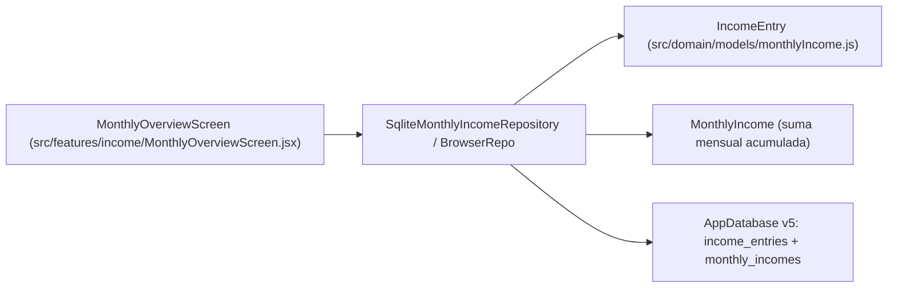

# Design — h15_ingresos_multiples

> Decisiones técnicas para H15 (`h15_ingresos_multiples`, orden 15 del flujo SDD). Apoyado en
> `docs/architecture.md`, `docs/data_model.md`, `docs/conventions.md` y `rules.md`.

## Contexto y arquitectura

`H15` transforma la gestión de ingresos para que el usuario pueda registrar múltiples entradas individuales en cualquier momento del mes (monto, fecha y concepto/nota opcional), listarlas, editarlas o eliminarlas igual que los gastos, y obtener como ingreso mensual del período la suma acumulada de todas las entradas registradas, preservando al 100 % el contrato `findByYearMonth(yearMonth) -> MonthlyIncome | null` consumido por `H5`, `H6`, `H10`, `H13` y `H14`.



## Archivos por capa

| Capa | Archivo | Cambio |
|---|---|---|
| domain | `src/domain/models/monthlyIncome.js` | Agregar clase inmutable `IncomeEntry({ id, amountCents, date, note, createdAt })` y función pura `sumIncomeEntries(entries, yearMonth)` |
| domain | `src/domain/repositories/monthlyIncomeRepository.js` | Extender el contrato con `addEntry(entry)`, `findEntriesByYearMonth(yearMonth)`, `updateEntry(entry)` y `deleteEntryById(id)` manteniendo `save` y `findByYearMonth` |
| data | `src/data/db/appDatabase.js` | Agregar `MIGRATION_V5_SQL` (`CREATE TABLE income_entries`, índice `idx_income_entries_date`) y subir `PRAGMA user_version = 5` |
| data | `src/data/repositories/sqliteMonthlyIncomeRepository.js` | Implementar `addEntry`, `findEntriesByYearMonth`, `updateEntry` y `deleteEntryById` sincronizando la suma del período en `monthly_incomes` |
| presentation | `src/features/income/MonthlyOverviewScreen.jsx` | Extender la pestaña `income` (y `MonthlyOverviewController`) con `incomeDateInput` (por defecto `today()`), `incomeNoteInput`, modo edición/baja de ingresos individuales, listado `income-entries-list` y acumulación automática al enviar `monthly-income-form` |
| app | `src/App.jsx` | Extender `incomeRepo` en `localStorage` (`fp_income_entries` + sincronización en `fp_incomes`) con `addEntry`, `findEntriesByYearMonth`, `updateEntry` y `deleteEntryById` |
| docs | `docs/data_model.md` | Documentar la tabla `income_entries` y la migración v5 |
| test | `test/domain/models/monthlyIncome.test.js`, `test/data/sqliteMonthlyIncomeRepository.test.js`, `test/features/income/MonthlyOverviewScreen.test.jsx`, `test/data/sqliteAdviceRequestRepository.test.js` | Agregar pruebas `[H15-R1]`..`[H15-R8]` y actualizar las 2 aserciones de `user_version` en `[H10-R25]` a `>= 4` |

## Firmas nuevas y extendidas

```javascript
// src/domain/models/monthlyIncome.js
export class IncomeEntry {
  constructor({ id = null, amountCents, date, note = null, createdAt = null }) { /* ... */ }
  copyWith(patch = {}) { /* ... */ }
}

// src/data/repositories/sqliteMonthlyIncomeRepository.js
export class SqliteMonthlyIncomeRepository extends MonthlyIncomeRepository {
  async addEntry(incomeEntry) { /* INSERT INTO income_entries + recalcula monthly_incomes */ }
  async findEntriesByYearMonth(yearMonth) { /* SELECT ... WHERE substr(date,1,7) = ? ORDER BY date DESC, id DESC */ }
  async updateEntry(incomeEntry) { /* UPDATE income_entries + recalcula monthly_incomes */ }
  async deleteEntryById(id) { /* DELETE FROM income_entries + recalcula monthly_incomes */ }
  async save(monthlyIncome) { /* Compatibilidad directa con H5/H10 */ }
  async findByYearMonth(yearMonth) { /* Devuelve MonthlyIncome con la suma acumulada del mes o null */ }
}
```

## Decisiones de diseño y compatibilidad

1. **Sincronización entre `income_entries` y `monthly_incomes` (`R4`, `R5`):**
   - Cada vez que se invoca `addEntry`, `updateEntry` o `deleteEntryById`, el repositorio calcula `SELECT COALESCE(SUM(amount_cents), 0) AS total FROM income_entries WHERE substr(date, 1, 7) = ?`.
   - Si `total > 0`, actualiza `monthly_incomes` para ese `year_month` con `total`; si `total === 0`, elimina la fila de `monthly_incomes` para ese `year_month`.
   - Así, `findByYearMonth(yearMonth)` sigue devolviendo un `MonthlyIncome` con el total acumulado del mes (o `null` si no hay ingresos), por lo que `loadSpendingSummary` (`H10`), los KPIs de `overview` (`H5`, `H13`, `H14`) y `calculateCategoryIncomeBreakdown` (`H5`, `H6`) funcionan automáticamente con la suma de múltiples ingresos sin romper ninguna prueba existente.
2. **Acumulación desde el formulario y el controlador (`R6`, `R7`, `R8`):**
   - En `MonthlyOverviewController` y `MonthlyOverviewScreen`, enviar el formulario de ingresos (`submitMonthlyIncome` / `handleSaveIncome`) crea un nuevo `IncomeEntry` (o actualiza el ingreso en edición si `editingIncomeId !== null`) usando `incomeRepo.addEntry` (si el repositorio inyectado lo provee; si es un stub mínimo de prueba que solo tiene `save`, acumula sobre el `monthlyIncome` previo y llama a `save`).
   - Tras registrar un ingreso nuevo, `incomeInput` e `incomeNoteInput` se limpian (`''`) para permitir cargar inmediatamente otro ingreso, mientras que `incomeDateInput` se mantiene en la fecha del día por defecto.
3. **Ajuste justificado en prueba previa de migración (`R3`):**
   - Al agregar la migración v5 en `AppDatabase`, la versión final de una base recién abierta pasa a ser `5`. En `test/data/sqliteAdviceRequestRepository.test.js` (`[H10-R25]`), las 2 aserciones `assert.equal(Number(version.user_version), 4)` se actualizan a `assert.ok(Number(version.user_version) >= 4)` (siguiendo el mismo criterio aprobado en `H10` para `[H9-R6]`).

## Impacto en privacidad (Ley 25.326)

- Los conceptos/notas individuales de cada `IncomeEntry` se almacenan solo localmente (`SQLite` y `localStorage`) y **nunca** se envían al modelo de lenguaje: `loadSpendingSummary` (`H10`) solo lee `monthlyIncome.amountCents` (el entero total del mes).
