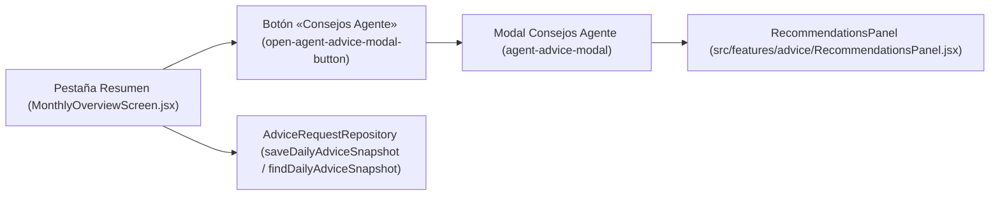

# Design — h16_modal_consejos_agente

> Decisiones técnicas para H16 (`h16_modal_consejos_agente`, orden 16 del flujo SDD). Apoyado en
> `docs/architecture.md`, `docs/conventions.md`, `docs/llm_assistant.md` y `rules.md`.

## Contexto y arquitectura

`H16` reubica estructuralmente el módulo de recomendaciones del asistente (`H10`) desde el final de la pestaña `Alertas` (`reminders`) hacia la pestaña principal `Resumen` (`overview`), exponiendo un botón inferior **«Consejos Agente»** que abre un modal dedicado (`agent-advice-modal`). Además, persiste localmente el último resultado de consejos solicitado en el día actual (`today()`) para que, si el usuario ya pidió consejos ese día, al abrir el modal vea de inmediato la última respuesta solicitada sin consumir una nueva consulta.



## Archivos por capa

| Capa | Archivo | Cambio |
|---|---|---|
| domain | `src/domain/repositories/adviceRequestRepository.js` | Extender el contrato con métodos opcionales `saveDailyAdviceSnapshot(snapshot)` y `findDailyAdviceSnapshot(date, yearMonth)` |
| data | `src/data/repositories/localStorageAdviceRequestRepository.js` | Implementar `saveDailyAdviceSnapshot` y `findDailyAdviceSnapshot` bajo la clave `fp_last_daily_advice` en `localStorage` |
| data | `src/data/repositories/sqliteAdviceRequestRepository.js` | Implementar `saveDailyAdviceSnapshot` y `findDailyAdviceSnapshot` asociados a la instancia `AppDatabase` para conservar el último consejo del día entre instancias del repositorio |
| presentation | `src/features/income/CategoryDistributionChart.jsx` | Ajustar `card.height`/`maxHeight` en mobile compacto a `330px` (`breakdownList.maxHeight: 190px`) para dar mayor altura al listado scrolleable de categorías dejando espacio exacto al botón inferior «Consejos Agente» sin scroll vertical en `Resumen` |
| presentation | `src/features/income/MonthlyOverviewScreen.jsx` | Quitar `RecommendationsPanel` de la pestaña `reminders`; agregar en `overview` el botón inferior «Consejos Agente» (`open-agent-advice-modal-button`), el estado/métodos `isAdviceModalOpen`, `openAdviceModal()`, `closeAdviceModal()`, el modal `agent-advice-modal` con `close-agent-advice-modal-button` y `agent-advice-last-requested-badge`, y la restauración automática del snapshot del día actual (`today()`) |
| test | `test/features/income/MonthlyOverviewScreen.test.jsx` | Actualizar las pruebas de integración de `H10` al modal en `Resumen` y agregar las pruebas `[H16-R1]`..`[H16-R7]` |

## Firmas nuevas y extendidas

```javascript
// src/domain/repositories/adviceRequestRepository.js
export class AdviceRequestRepository {
  // ...
  async saveDailyAdviceSnapshot(_snapshot) { return null; }
  async findDailyAdviceSnapshot(_date, _yearMonth) { return null; }
}

// src/features/income/MonthlyOverviewScreen.jsx — MonthlyOverviewController
openAdviceModal()  // this.isAdviceModalOpen = true
closeAdviceModal() // this.isAdviceModalOpen = false
```

## Decisiones de diseño

1. **Botón «Consejos Agente» al pie del Resumen sin romper `overflowY: 'hidden'` (`R1`, `R7`):**
   - El botón `data-testid="open-agent-advice-modal-button"` se ubica como último hijo de `overview-viewport-box` (`flexShrink: 0`).
   - En Mobile (`< 768px`), la tarjeta compacta de `CategoryDistributionChart` utiliza `height: 330` y `breakdownList.maxHeight: 190` (manteniendo el listado de categorías amplio y scrolleable internamente), de modo que el encabezado de período, los 4 KPIs, el gráfico, la barra de asignación de capital y el botón «Consejos Agente» entran íntegramente en un único viewport móvil sin scroll vertical.
2. **Persistencia y restauración del último consejo solicitado en el día (`R3`, `R4`, `R5`, `R6`):**
   - Al completarse `requestAdvice()`, se guarda `{ date: formatIsoDate(today()), yearMonth: activeYearMonth, suggestions, source, reason }` mediante `adviceRequestRepository.saveDailyAdviceSnapshot(...)`.
   - Al inicializar la pantalla o recargar los datos del período activo, se consulta `adviceRequestRepository.findDailyAdviceSnapshot(formatIsoDate(today()), activeYearMonth)`. Si existe un snapshot para el día de hoy (`date === formatIsoDate(today())`) y el período activo, `advice` se hidrata con `status: 'ready'` y las sugerencias guardadas sin invocar a `LlmClient`.
   - Si la fecha `today()` cambia al día siguiente, `findDailyAdviceSnapshot` devuelve `null` y el modal inicia en `status: 'idle'` mostrando el botón «Pedir recomendaciones».

## Impacto en privacidad (Ley 25.326)

- El snapshot diario almacena únicamente las sugerencias ya recibidas o generadas por reglas en el almacenamiento local del navegador (`localStorage` / memoria de `AppDatabase`), sin enviar ningún dato adicional por red ni modificar el contrato de privacidad de `H10` y `H12`.
